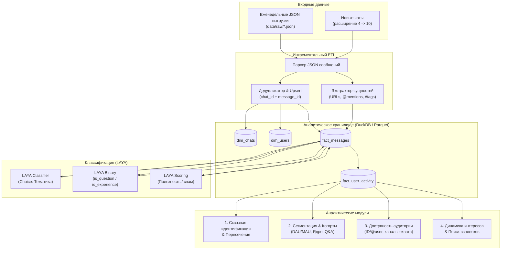

# Архитектура аналитического конвейера Chat-analytics

## 1. Обзор системы и цели

Проект предназначен для сквозного анализа аудитории русскоязычных сообществ Telegram по Таиланду с **регулярным еженедельным обновлением**.

---

## 2. Модель хранения данных (DuckDB + Parquet)

Для объемов в сотни тысяч и миллионы сообщений реляционные СУБД (Postgres) требуют инфраструктуры, а плоские JSON не позволяют делать быстрые срезы. Оптимальный выбор — **DuckDB**:
- Работает локально в одном файле `data/processed/analytics.duckdb`.
- Колоночное хранение, мгновенный расчет когорт, оконных функций и группировок по миллионам строк.
- Бесшовная интеграция с Python (pandas, polars, pyarrow) и SQL.

### Схема таблиц

1. **`dim_chats`**
   - `chat_id` (BIGINT, PK) — Telegram ID чата.
   - `chat_name` (VARCHAR) — название чата.
   - `chat_username` (VARCHAR, nullable) — публичный `@username`.
   - `first_message_date` (TIMESTAMP).
   - `last_message_date` (TIMESTAMP).
   - `total_messages` (BIGINT).

2. **`dim_users`**
   - `user_id` (BIGINT, PK) — сквозной Telegram User ID (`from_id`).
   - `display_name` (VARCHAR) — имя пользователя.
   - `username` (VARCHAR, nullable) — `@username` (если доступен).
   - `is_bot` (BOOLEAN).
   - `first_seen_at` (TIMESTAMP) — дата первого обнаруженного сообщения в любом чате.
   - `last_seen_at` (TIMESTAMP) — дата последнего сообщения.
   - `chats_count` (INTEGER) — в скольких чатах писал.

3. **`fact_messages`**
   - `message_id` (BIGINT) — ID сообщения внутри чата.
   - `chat_id` (BIGINT) — ID чата (составной PK: `chat_id` + `message_id`).
   - `user_id` (BIGINT, FK) — автор.
   - `date` (TIMESTAMP) — время отправки.
   - `text` (VARCHAR) — очищенный текст.
   - `reply_to_message_id` (BIGINT, nullable).
   - `views` (INTEGER, default 0).
   - `forwards` (INTEGER, default 0).
   - `reactions_count` (INTEGER, default 0).
   - `reactions_details` (JSON) — эмодзи и количество.
   - `urls` (VARCHAR[]) — извлеченные ссылки.
   - `mentioned_usernames` (VARCHAR[]) — упомянутые `@username`.
   - `topic_category` (VARCHAR, nullable) — категория, размеченная LAYA.
   - `is_question` (BOOLEAN, nullable) — вопрос ли это.
   - `is_experience` (BOOLEAN, nullable) — личный опыт пользователя.
   - `relevance_score` (FLOAT, nullable) — оценка информативности.

---

## 3. Регулярность и инкрементальная загрузка (Weekly Updates)

Еженедельно поступает порция данных: новый дамп за последние 7 дней (или перекрывающийся срез).
- **Идемпотентность**: `INSERT INTO fact_messages ... ON CONFLICT (chat_id, message_id) DO UPDATE SET views = EXCLUDED.views, reactions_count = EXCLUDED.reactions_count, reactions_details = EXCLUDED.reactions_details`.
- Реакции и просмотры могут расти постфактум — обновление по первичному ключу сохраняет актуальность.
- Автоматический расчет метрик недели без полного пересчета всей 5-летней истории.

---

## 4. Решение четырех ключевых задач заказчика

### Задача 1. Идентификация и сквозной профиль
- **Сквозной ID**: Внутренний Telegram `user_id` (числовой идентификатор из `from_id: "user123456789"`) **устойчив и неизменен** во всех чатах.
- **Объединение истории**: Позволяет составить сквозную карточку пользователя:
  - В каких городах/чатах Таиланда появляется (Пхукет, Паттайя, Самуи, Бангкок).
  - Эволюция запросов: от "как въехать / какая страховка" до "как открыть счет / продлить DTV / снять кондо".
- **Граф перекрытия аудитории**: матрица совместного участия (Jaccard similarity между чатами), показывающая, какая доля аудитории кочует между чатами, а какая замкнута в одном сообществе.

### Задача 2. Сегментация аудитории
- **По частоте и активности**:
  - `Daily Active` (пишут >= 4 дней в неделю), `Weekly Active` (>= 2 недель в месяц), `Monthly Active`, `One-timers` (1-2 сообщения за всю историю).
- **Когортный анализ (Retention)**:
  - Месяц первого появления пользователя (Когорта) -> % пользователей, написавших в месяце M+1, M+2, ..., M+12.
- **Ролевая сегментация (Q&A Framework)**:
  - *Вопрошающие (Askers)*: `is_question = true`, низкий процент ответов (`reply_to_message_id is null`), активность короткими кластерами.
  - *Эксперты / Ядро (Responders)*: регулярные ответы на чужие сообщения (`reply_to_message_id is not null`), высокий рейтинг реакций на сообщения, длительный срок жизни в чате.
  - *Инфо-распространители (Broadcasters)*: частые ссылки, пересылки, посты без диалога.

### Задача 3. Доступность аудитории
- **Идентификаторы**:
  - `user_id`: 100% реальных профилей.
  - `@username`: присутствует у части пользователей (определим точную долю на аудите данных).
- **Механики взаимодействия и реалистичные охваты**:
  1. **Telegram Ads**:
     - В официальном кабинете таргетинг идет по каналам, языку и интересам, а также через списки (Custom Audiences по телефонам). Таргетинг напрямую по `user_id` ограничен экосистемой Mini Apps и кастомными партнерскими программами.
  2. **Боты и Telegram Mini Apps (TMA)**:
     - Если запускается сервис (например, визовый калькулятор или бот-помощник по Таиланду), зная целевых активных участников, можно вовлекать их через посевы в чатах. Как только пользователь кликнул бота, его `user_id` активирует прямой канал push-уведомлений.
  3. **Прямой аутрич (MTProto / Userbots)**:
     - Технически возможен по `user_id` (если есть общий чат), но несет риск спам-блокировки. Рекомендуется только точечный контакт с ключевым ядром/экспертами.
  4. **Look-alike и Enrichment**:
     - Обогащение базы через открытые каналы/боты.

### Задача 4. Динамика тем и кейс виз (DTV / 15.09.2026)
- **Ежедневный временной ряд**: объем сообщений, вовлеченность (reactions/message), уникальные авторы.
- **Детекция всплесков (Anomaly/Spike Detection)**:
  - Алгоритм: вычисление $Z$-оценки суточного объема сообщений по ключевым кластерам слов ("въезд", "виза", "DTV", "штамп", "30 дней", "60 дней", "бордер", "визаран").
  - Выявление пиковых дней (например, 15 сентября 2026 г. и прилегающие даты).
- **Анализ первоисточников (First Movers & Key Nodes)**:
  - Сортировка сообщений по времени внутри окна начала всплеска.
  - Поиск первого сообщения, содержащего новость или ссылку.
  - Построение дерева цитирования: какие сообщения получили больше всего `replies` и положительных/отрицательных реакций.
- **Анализ ссылок и документов**:
  - Топ доменов и нормативных источников (официальные сайты МИД Таиланда, иммиграционные порталы, конкретные PDF или посты в каналах).

---

## 5. Роль и интеграция LAYA (`NandhaKishorM/laya`)

### Почему не тяжелые LLM?
Обработка миллионов сообщений через GPT-4/Claude/Llama-70B:
- Дорого (сотни/тысячи долларов в месяц на API).
- Медленно (секунды на генерацию каждого ответа).
- Избыточно для задач классификации ("Это вопрос или ответ?", "Какая тема?").

### Что делает LAYA:
LAYA — локальная легковесная модель single forward pass (System 1 reasoning, задержка < 40 мс):
1. **Категоризация (Choice)**:
   - `Классы`: `[visa_entry, housing_rent, money_exchange, transport_bike, work_business, health_insurance, tourism_leisure, flood_casual]`.
2. **Детекция интента (Binary)**:
   - `is_question`: Является ли сообщение вопросом о правилах/помощи?
   - `is_personal_case`: Описывает ли автор свой реальный кейс прохождения границы / получения визы?
3. **Оценка полезности (Scoring)**:
   - Шкала 1–5: отсечение флуда («спасибо», «ок», стикеры) от содержательных инструкций.

### Аппаратное обеспечение:
На машине доступна **NVIDIA GeForce RTX 3060 (12GB VRAM)**. LAYA разворачивается локально на GPU, обеспечивая пакетную обработку сотен сообщений в секунду абсолютно бесплатно и автономно.

---

## 6. Расширение до 10 чатов и выгрузка @visadtv

1. **Алгоритм отбора 6 чатов**:
   - Парсинг сообщений 4 чатов на сущности: ссылки `t.me/<name>`, `t.me/joinchat/...`, `@<username>`.
   - Метрики:
     - Общее число упоминаний ($N$).
     - Число **уникальных пользователей-рекомендателей** ($U$).
     - Отсечение спам-ботов: исключение пользователей, у которых 90%+ сообщений содержат ссылки.
   - Ранжирование по $U \times \log(N)$ и выбор топ-6 чатов по Таиланду.
2. **Выгрузка @visadtv**:
   - Проверка публичности группы: если публичная, экспорт истории выполняется через Telegram Desktop либо через скрипт на базе библиотеки `telethon` (MTProto API).
